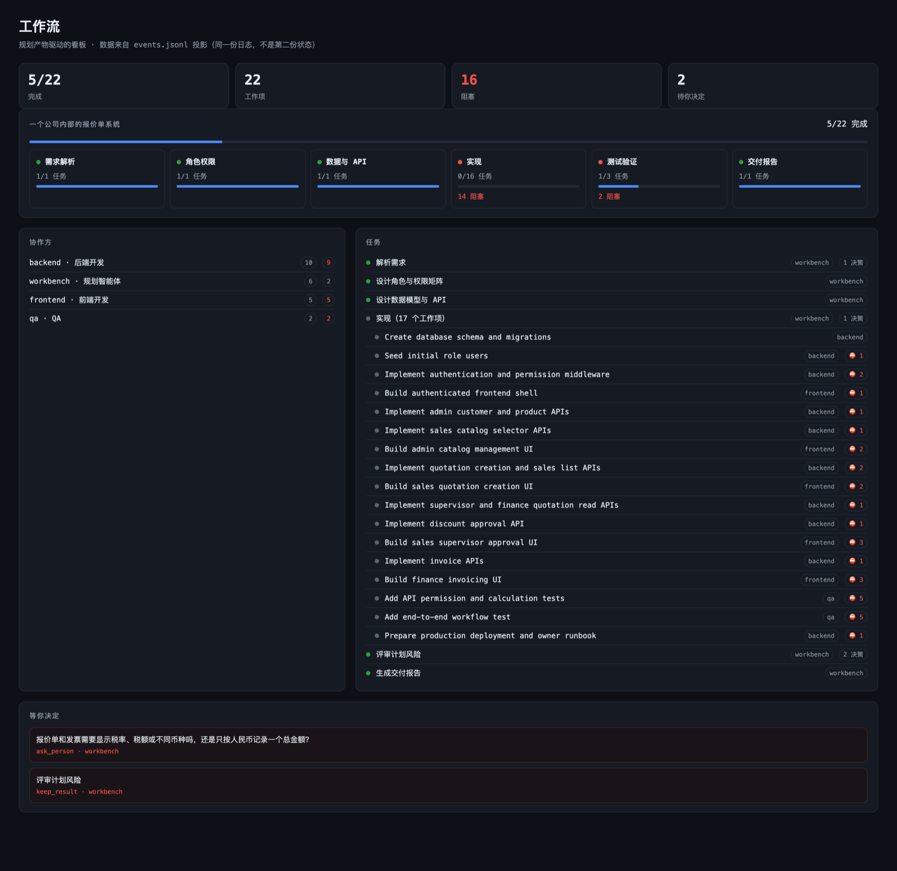
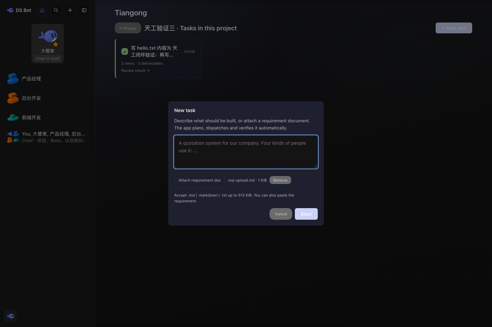
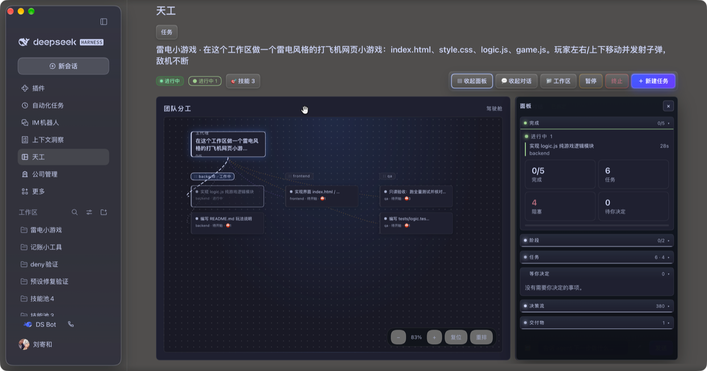

# 天工 / Tiangong Workbench

A **requirement-to-delivery workbench** for [DeepSeek Harness](https://github.com/deepseek-ai/deepseek-harness) (`dsh`).

Create an app (or a project), describe what you need or attach a requirement document, and the
workbench runs the loop: it understands the requirement, plans a task graph, dispatches child
agents, verifies their test evidence, and records the delivery — with as little manual
intervention as possible. Every task stays bound to its own DSH session.

The plugin lives in [`packages/workbench`](packages/workbench). This public repository contains the
generic workbench only; deployment-specific panel modules are kept out of it on purpose.



| Requirement upload | Team flow |
|---|---|
|  |  |

## Features

- **Requirement intake** — paste text or attach a `.md` / `.markdown` / `.txt` document (≤512 KiB) in the panel.
- **Planning as a contract** — the agent submits a validated DAG (owners, stages, dependencies, acceptance criteria); invalid plans are rejected with the exact reason.
- **Dispatch loop** — one ready work item at a time goes to a child agent, gets woken when it stalls, and reports back with test evidence.
- **Evidence-gated completion** — a work item is done only with a real exit code, a positive pass count and zero failures; otherwise it becomes a person's decision.
- **Per-project delivery session** — each project gets a durable DSH session; the ledger records the binding, model and agent preset.
- **Task cockpit** — team graph, task list, decisions, usage and delivery artifacts for every job.
- **Accounting and gates** — token usage and cost, budgets, stall watchdog and round trip-breakers, with human gates on the exceptions.

## Install

Requires DSH **0.2.1-rc.0 or newer** (`engines.dsh` in `packages/workbench/package.json`).

```bash
git clone https://github.com/jossion/dsh-tiangong.git
dsh plugin --profile <profile> add /path/to/dsh-tiangong/packages/workbench
```

Restart DSH, then check **Plugins → Installed** for `@jos/workbench`; the **天工 / Tiangong** entry
appears in the sidebar. The same package directory can be added through DSH's Plugin Manager
(`install_bundle`) instead of the CLI.

## Configuration

`@jos/workbench` exports a Schemastery `Config`, validated when the row activates and visible in
Plugin Manager. The important fields:

| Field | Default | Meaning |
|---|---|---|
| `dataDir` | `""` | Ledger and deliveries location; empty means `~/.dsh/workbench` |
| `appsRoot` | `""` | Root for app workspaces; empty means `<dataDir>/apps` |
| `agentPreset` | `""` | Agent preset for delivery sessions |
| `autoRun` | `true` | Drive intake-created jobs automatically |
| `planTimeoutMs` / `planNudgeMs` | `900000` / `120000` | Planning timeout and one reminder |
| `maxRounds` | `60` | Wake-round trip-breaker per job |
| `budgetUsd` / `budgetTokens` | `0` | Budgets; `0` disables the gate |
| `priceInputPerMTok` / `priceOutputPerMTok` | `0` | USD per 1M tokens for cost accounting |
| `stallAfterWakes` | `6` | Wakes without board progress before the stall gate fires |

## Data

The append-only ledger `~/.dsh/workbench/events.jsonl` is the single source of truth; every panel
view is a projection of it.

## Development

```bash
cd packages/workbench
npm test
```

## License

Apache-2.0. See [LICENSE](LICENSE).
