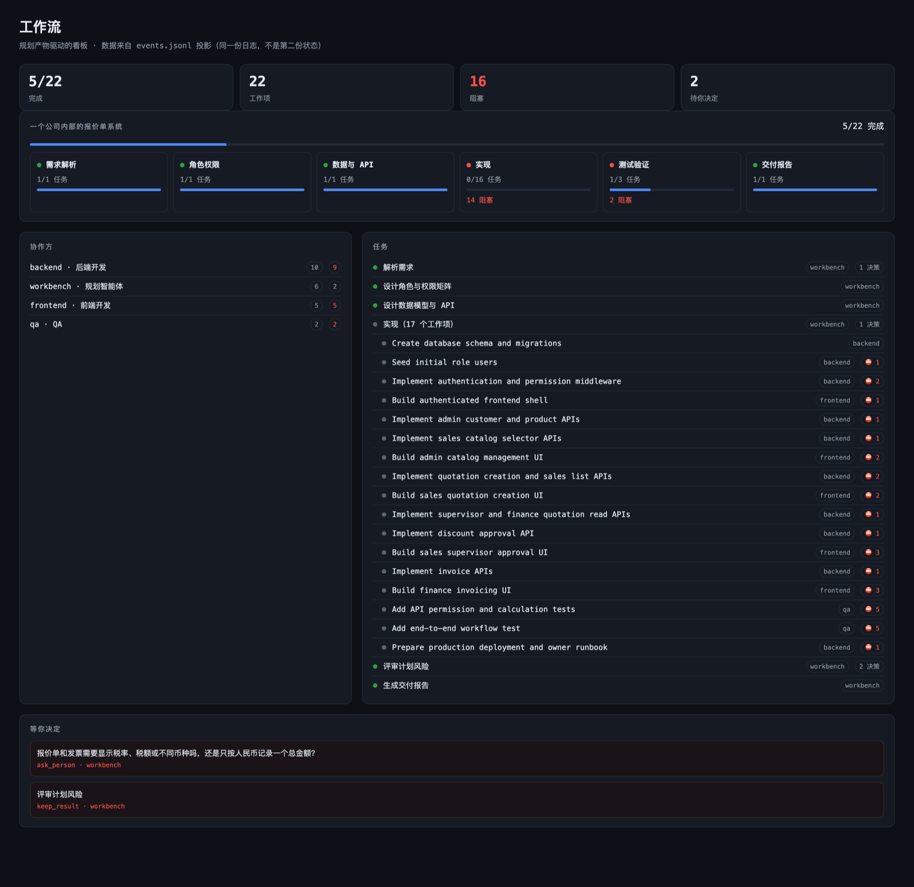

# 天工 / Tiangong Workbench

A **requirement-to-delivery workbench** for [DeepSeek Harness](https://github.com/deepseek-ai/deepseek-harness) (`dsh`).

Create a project, paste a requirement or attach a document, and the workbench runs the loop: it binds a
delivery session, has the main agent plan a validated task graph, dispatches child agents per card,
gates completion on real test evidence, and records everything in an append-only ledger. The result is
a series of auditable tasks with their own cockpits — not one opaque run.



> 国内镜像 / China mirror: [gitee.com/jossion/dsh-tiangong](https://gitee.com/jossion/dsh-tiangong)

## Capabilities

- **Project types** — software delivery, copy writing and custom; a type binds the lead-agent preset, a
  global-tool mask and a workspace template (`AGENTS.md` + `docs/`).
- **Requirement intake** — text or `.md` / `.markdown` / `.txt` (≤512 KiB); a change request can name
  the delivered task it follows (`parentJobId` + `kind`).
- **Closed loop** — bind a delivery session → the main agent plans a DAG → ready cards go to child
  agents → evidence-gated completion → delivery line.
- **Planning budget** — ≤10 tool calls / ~3 minutes, a steer reminder at 2 minutes, hard stop at 5
  minutes (configurable).
- **Evidence-gated done** — a card is done only with exit code 0, a positive pass count and zero
  failures; everything else becomes a person's decision.
- **Task groups** — one card per root task; its change requests are compact rows, with a task-group
  breadcrumb in the cockpit.
- **Cockpit** — team graph, stage rail, progress / gates / decisions / deliverables panels, pause,
  cancel, workspace binding and token accounting.
- **Conversation** — shows the requirement and the final answer of each turn; process output and
  subagent notices stay out of the way. Images and voice input are supported.
- **Voice input** — records in the browser and transcribes through the host's shared speech-to-text
  service (same model and settings as DSH's own voice input).
- **Circuit breakers** — stall watchdog, round trip-breaker, optional token/USD budget, human gates on
  the exceptions.

## Install

Requires DSH **0.2.1-rc.0 or newer** (`engines.dsh`).

```bash
git clone https://github.com/jossion/dsh-tiangong.git
dsh plugin --profile <profile> add /path/to/dsh-tiangong/packages/workbench
```

Restart DSH, confirm `@jos/workbench` is active, and open the **天工 / Tiangong** entry in the sidebar.
For voice input, enable DSH's `voice-input-bundle` as well; the workbench shares its model and settings.

## Documentation

- Package README (capabilities, plan protocol, HTTP API, configuration, limitations):
  [`packages/workbench/README.md`](packages/workbench/README.md)
- 中文用户手册:
  [`packages/workbench/docs/USER-GUIDE.md`](packages/workbench/docs/USER-GUIDE.md)

## Repository layout

```
packages/workbench/     the plugin package (host + web client + tests + docs)
```

The company module (`@jos/company`) is a separate private bundle mounted beside the workbench in a
deployment; it is not part of this repository.

## License

Apache-2.0. See [LICENSE](LICENSE).
