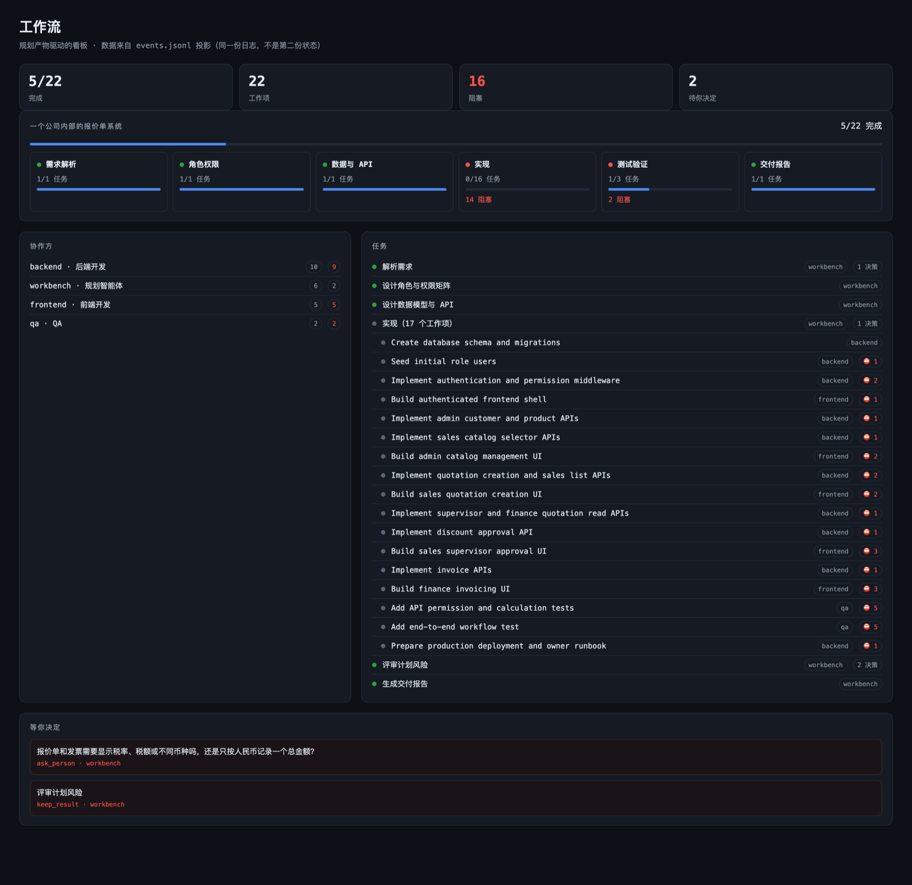
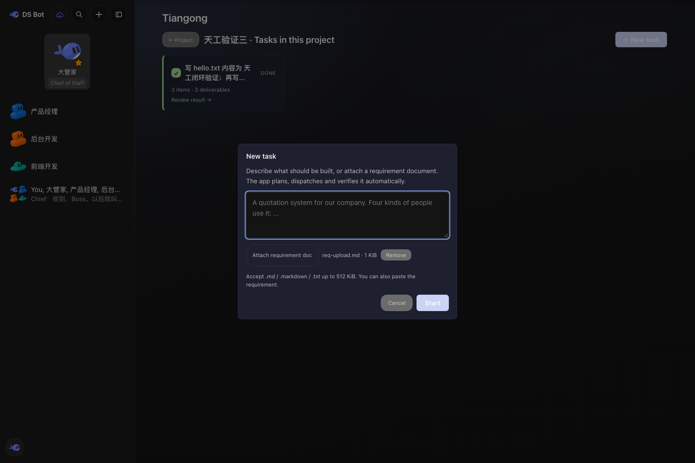
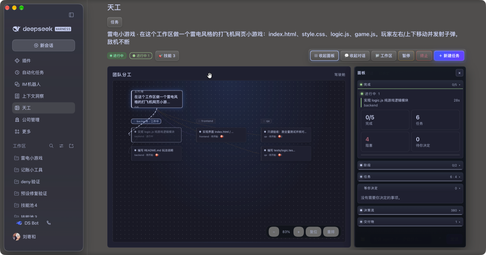
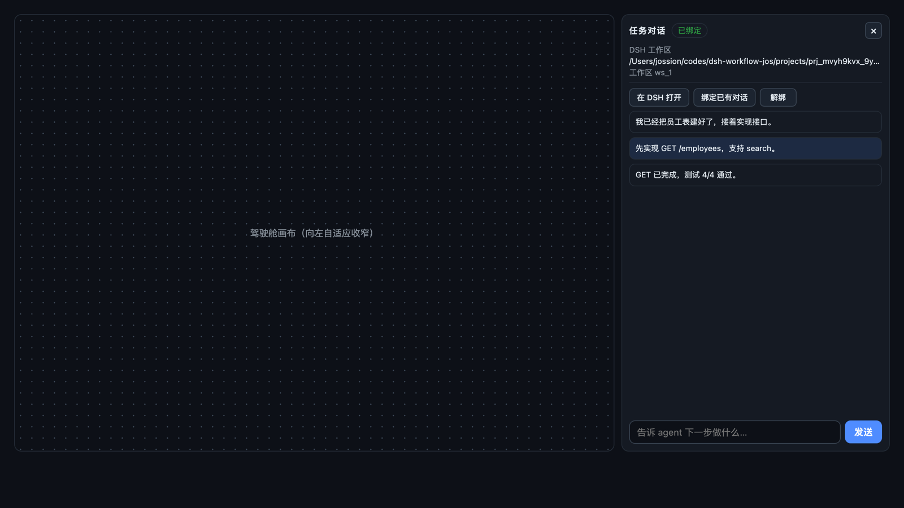

# 天工 / Tiangong Workbench

A **requirement-to-delivery workbench** for [DeepSeek Harness](https://github.com/deepseek-ai/deepseek-harness) (`dsh`).

Create a project, describe what you need or attach a requirement document, and the workbench runs the
loop: it binds a delivery session, has the main agent plan a validated task graph, dispatches child
agents per card, gates completion on real test evidence, and records the whole thing in an append-only
ledger. Every task keeps its own cockpit; the delivered result stays auditable.



> Capability inventory below is current as of **2026-11-04** (workbench `0.6.0`).
> 中文用户手册：[docs/USER-GUIDE.md](docs/USER-GUIDE.md).

## What it does

- **Project types** — the create-project wizard offers **software delivery**, **copy writing** and **custom**; a type binds a lead-agent preset, a global-tool mask and a workspace template.
- **Requirement intake** — paste text or attach `.md` / `.markdown` / `.txt` (≤512 KiB; text ≤20 000 chars) right in the panel. A change request can name the delivered job it follows.
- **Planning as a contract** — the main agent submits a validated DAG (`workbench_submit_plan`) with owners, stages, dependencies and acceptance criteria; invalid plans are rejected with every issue at once.
- **Dispatch loop** — one round at a time: ready cards go to child agents with a complete prompt, results come back through `workbench_report_work`.
- **Evidence-gated completion** — a card is done only with a real exit code, a positive pass count and zero failures; anything else lands on a person.
- **Task groups, not card sprawl** — a delivered task and its change requests render as one root card plus its changes; the ledger still keeps one immutable job per change.
- **Cockpit** — team graph, stage rail, HUD panels (progress / stages / tasks / gates / decisions / deliverables), live status, pause/resume/cancel, usage, workspace and conversation. The page fills the viewport with an 8px gap above and below; the conversation column never sizes the page. Click any work card (canvas or task rail) for a detail sheet: instructions, acceptance, dependencies, the bound child session, artifacts and gates. A drag does not open the sheet.
- **Conversation that hides the process** — the panel shows your requirement and the final answer of each turn, not planning directives, tool calls or subagent notices.
- **Voice input** — record in the browser, transcribe on the host through DSH's shared speech-to-text service, insert the text into the draft.
- **Automatic accounting and circuit breakers** — tokens per job, optional USD budget, stall watchdog, round trip-breaker and a hard planning timeout, each exception as a human gate.

| Requirement upload | Team flow |
|---|---|
|  |  |



## The closed loop

The plugin is the scheduler; the main agent decides; child agents execute. Every tick is one pure
decision (`orchestrator.nextStep`), and the ledger is the only source of truth.

| Action | When | Who acts |
|---|---|---|
| `bind-session` | a job has no delivery session | host: create/resume one session per project |
| `start-planning` | no plan yet, no planning turn in flight | host: wake the main agent with the planning directive |
| `plan-timeout` | planning exceeded `planTimeoutMs` (default **5 min**) | host: human gate, then **parks** the job |
| `wake` | ready cards and an idle main agent | host: wake with the dispatch round |
| `wait` | planning / working / cooldown / dependencies | scheduler: wait for the next event |
| `human-gate` | blocking approval, failure, too many rounds, budget | panel: “等你决定” |
| `complete` | every leaf card is done | host: write the delivery line |
| `idle` | paused / cancelled / delivered / manual mode | — |

Planning is budgeted: the delivery agent is told to spend **≤10 tool calls / ~3 minutes** and to put
root-cause work into a `diagnose` card instead of investigating during planning. A single reminder is
delivered at **2 minutes as a `steer` message** (it reaches the running turn at its next step boundary),
and the planning turn is hard-stopped at `planTimeoutMs`.

## Project types and capability profiles

A project is a capability profile, not only a name. `projects.js` stores the
profile on the project line and `profiles.js` resolves it:

| Type | Preset | Tool surface | Workspace template |
|---|---|---|---|
| `software` | `workbench-software` | plan / read / dispatch / verify; 3D, browser and bot tool families masked | `AGENTS.md` + `docs/` + acceptance gate |
| `copy` | `workbench-copy` | read / write / search / review; shell, 3D, browser and bot tool families masked | `AGENTS.md` + `docs/` + review checklist |
| `custom` | deployment default | nothing masked | none |

- The preset (declared in this bundle's `cordis.patch.yml`) owns the lead's
  persona and its scoped tool composition.
- The mask is applied with `tools.restrict()` on the delivery session's agent
  scope, because a preset cannot remove tools that other plugins registered
  globally. Only names the deployment actually registered are denied.
- `POST /workbench/projects` accepts `{ name, kind, workspace? }`; a workspace
  must be an existing allowed absolute directory. The wizard's third step lets
  you type a path **or** choose a folder with the host's native picker
  (`POST /workbench/pick-path`, Electron or the OS helper). Leave it empty and
  the host assigns `~/.dsh/workbench/apps/<project>`.
- When a workspace is given, `AGENTS.md` and `docs/README.md` are seeded
  without overwriting existing files.

## Requirement intake

`POST /workbench/requirements` accepts:

```json
{ "projectId": "prj_…", "text": "…", "file": { "name": "req.md", "base64": "…" },
  "parentJobId": "deliveries_…", "kind": "change|fix|feature" }
```

- `text` or `file` is required; both may be present (the file is prepended).
- Accepted documents: `.md`, `.markdown`, `.txt` up to 512 KiB; text up to 20 000 chars.
- `parentJobId` (optional) must name an existing job in the same project; `kind` must be one of
  `change` / `fix` / `feature`. Together they form a **change request** — a new immutable job linked to
  the delivered one.
- The route answers `202 accepted` with the new `jobId`; the board is the progress channel.
- The panel opens the new job’s cockpit as soon as it is created.

## Plan protocol

`workbench_submit_plan({ jobId, brief, roles?, design?, tasks:[{ id, title, owner, stage, blockedBy?, instructions?, acceptance?, skill? }] })`

- `tasks` non-empty (≤200), ids unique (`[A-Za-z0-9][A-Za-z0-9._-]*`, ≤64), titles ≤200, text ≤4000.
- `blockedBy` may only reference ids in the same plan, ≤32 blockers, no cycles.
- `owner ∈ {backend, frontend, qa, workbench}`; `stage ∈ {brief, roles, design, build, verify, report}`.
  `brief` / `roles` are planning-only; `design` / `build` / `verify` / `report` cards are
  dispatchable (a design-stage contract card used to deadlock everything behind it).
- A plan becomes a `plan` line, a build container card, and one addressable card per work item.

## Skills on cards

Card children had a 60-skill catalog injected but never loaded one. Since 0.6.0:

- planning requires `workbench_find_skill` plus the `skill` tool before submitting a plan;
- every card prompt tells the child to discover and load its skill and to name it in the report;
- the host observes the `skill` tool-result event, maps the calling agent to its card through
  `childSessionId`, and appends a `skill` task event (deduplicated);
- `workbench_report_work` also accepts an explicit `skills` list;
- the card detail sheet shows **Skills used** (or says none were recorded).

## Pause and resume children

Pause is not only a queue switch. Every card handed out with a bound child session
(`workbench_bind_child`) is paused the same way:

- **Pause** writes a checkpoint (`paused; child session … interrupted`) on each
  in-flight card and stops the child's current turn through the subagents
  service: `subagents.interrupt(child, { kind: 'ancestor', agent: deliveryLead })`.
  Child sessions live in that activation graph, not in the ordinary session
  controller, so cancelling them by session id answers "session not found"; and a
  model-side `interrupt_agent` resolves teammates in a team deployment. The
  ancestor authority names the exact live parent Agent instead.
- **Resume** sends the child a message from that same parent Agent
  (`subagents.sendMessage(lead, child, "continue, do not restart the card")`,
  passing the `AbortSignal` its options require). An idle or cold child resumes
  from its own persisted history, so the card is not re-executed from its prompt,
  and resume also works after a host restart.
- Pause can race the spawn: the card is claimed before its child id exists. When
  `workbench_bind_child` runs while the job is paused, the plugin stops that
  child immediately and records the checkpoint, so a paused job cannot keep
  spending through a child bound a moment too late.
- Repeated pause/resume does not re-message children (the route compares the
  state before the write), and cards whose children finished while paused are not
  addressed again.
- Cards without a bound child (older jobs, or a lead that never bound one) keep
  the old behavior: pause stops dispatch and nothing else.

## Dispatch, evidence, gates

- `workbench_next_work({ jobId?, projectId?, limit? })` returns ready cards with complete child prompts;
  handing a card out writes a `claimed` line, so the board shows **进行中** instead of “待执行”.
- `workbench_report_work` records the child’s evidence. **Done requires** `exitCode 0`,
  `testsPassed > 0` and `testsFailed === 0`; otherwise the card is blocked and a person decides.
- A card reported “done” without green tests becomes `blocked` (never silently done).
- Blocking approvals freeze the card (and its dependents) only; the rest of the job keeps moving.
- Human gates fire for: `session-unavailable`, `missing-requirement`, `plan-timeout`, `wake-failed`,
  `stalled`, `rounds`, `budget`, `budget-tokens`.
- Any irreversible action is never automated: it goes to the human lane.

## Task groups and change requests

- One root task = one card. Its change requests are compact rows inside that card (`后续 N 次修改`),
  and the root card shows `● N 进行中` when a change is running.
- The cockpit carries a **task group** breadcrumb (`员工管理 › 修复导出 › 修复导出2`) whose ancestors are
  clickable; direct follow-ups are listed as chips with their status and progress.
- A change request never rewrites the delivered job: lineage lives in `parentJobId` / `jobKind` on the
  new job line, and the old job keeps its 14/14 result, evidence and artifacts.

## Cockpit UI

- **Board** — project cards, live activity, create/delete; **project home** — deliverables, preview,
  one way into the tasks.
- **Task list** — grouped root cards with change rows and live status/progress.
- **Cockpit** — team graph (workbench / backend / frontend / qa lanes), stage rail, HUD panels:
  progress, stages, tasks, “等你决定”, decision stream, deliverables, usage.
- Toolbar: panels, manual execution (legacy jobs only), conversation, workspace, pause/resume,
  terminate, and the primary action (`＋ 新建任务` / `＋ 修改/修复` when done).
- Responsive: rails ≥1200 px, conversation side column ≥760 px, otherwise a stacked/drawer layout.
- Visual language: instrument-style toolbar with layered “keys”, a deep indigo primary button
  (5.0–5.6:1 contrast) with a slow breathing glow, `prefers-reduced-motion` respected.

## Conversation and voice

- The transcript is filtered to what a person said plus **the final answer of each turn**; planning
  directives, wake reminders, tool calls and subagent notices are hidden. The job’s requirement is shown
  as the first user bubble (it travels through the intake route, not the chat).
- Images: paste, drag or pick (≤4, ≤8 MB each), sent through DSH’s draft-attachment path.
- Voice: 🎤 records in the browser, decodes to **16 kHz mono PCM16 WAV**, posts to
  `POST /workbench/transcribe`; the host transcribes with its shared `speechToText` service
  (same model, settings and readiness as DSH’s own voice input) and the text is inserted into the draft
  (never auto-sent). Without the voice bundle the route answers `501 speech-unavailable`.

## Agent tools

| Tool | Purpose |
|---|---|
| `workbench_submit_plan` | submit the validated DAG for a job (planning turn) |
| `workbench_next_work` | list ready cards with child prompts; claims them active |
| `workbench_bind_child` | bind a card to the continuable subagent session carrying it (pause/resume address that child) |
| `workbench_report_work` | record a child’s files and test evidence; decides done/blocked/failed |
| `workbench_add_task` | add a discovered card to the same dependency graph |
| `workbench_find_skill` | search the session catalog and plugin market for a skill |
| `workbench_delivery_diagnostics` | diagnose session/preset/model wiring for a stuck job |
| `workbench_plan_software` | legacy host-side planner (kept for compatibility) |

## HTTP API

All routes are same-origin and sit behind the host connection fence.

| Path | Method | Purpose |
|---|---|---|
| `/workbench/state` | GET | projection: summary + board + events + planning + speech |
| `/workbench/requirements` | POST | closed-loop intake (new task or change request), 202 |
| `/workbench/start` | POST | legacy host-side planner, 202 (the panel no longer calls it) |
| `/workbench/projects` | POST/DELETE | create/delete a project card (delete writes a tombstone line) |
| `/workbench/control` | POST | `pause` / `resume` / `cancel` for a project or one job |
| `/workbench/decide` | POST | approve / reject a gate |
| `/workbench/job-config` | POST | job title / workspace / workspaceId / sessionId |
| `/workbench/project-config` | POST | legacy project workspace binding |
| `/workbench/task` | POST | manual task progress/evidence (the report tool writes events directly) |
| `/workbench/transcribe` | POST | proxy audio to the host speech-to-text service |
| `/workbench/pick-path` | POST | native file/directory picker |
| `/workbench/browse-path` | POST | list directories under allowed roots |

## Storage

- Ledger: `~/.dsh/workbench/events.jsonl` — append-only. Kinds: `project`, `job`, `requirement`,
  `plan`, `task`, `artifact`, `approval`, `delivery`, `usage`, `dispatch`, plus decision lines.
- Requirement documents: `~/.dsh/workbench/requirements/<jobId>.md`.
- Legacy artifacts: `~/.dsh/workbench/deliveries/<runId>/{roles,design,review}.json`.
- Project workspaces: the project directory (or `<dataDir>/apps/<projectId>`); delivered file paths
  are workspace-relative in cards and artifacts.
- Views (rail state, chat open state) live in `localStorage`; nothing important lives only there.

## Configuration

| Field | Default | Meaning |
|---|---|---|
| `dataDir` | `""` | Ledger/deliveries location; empty means `~/.dsh/workbench` |
| `appsRoot` | `""` | Root for app workspaces; empty means `<dataDir>/apps` |
| `agentPreset` | `""` | Agent preset for delivery sessions; empty uses the deployment default |
| `provider` / `model` | `""` | Route for the legacy host-side planner; empty uses the deployment default |
| `autoRun` | `true` | Drive intake-created jobs automatically |
| `wakeCooldownMs` | `15000` | Minimum gap between two wakes; 4 s was short enough that the same ready card was woken twice while a spawn was starting |
| `planTimeoutMs` | `300000` | Planning turn hard stop → human gate |
| `planNudgeMs` | `120000` | One steer reminder during planning |
| `maxRounds` | `60` | Wake-round trip-breaker per job |
| `budgetUsd` | `0` | USD budget; `0` disables the gate (prices must be set) |
| `budgetTokens` | `0` | Token budget; `0` disables the gate |
| `priceInputPerMTok` / `priceOutputPerMTok` | `0` | USD per 1M tokens for cost accounting |
| `loopTickMs` | `10000` | Safety-net loop interval |
| `stallAfterWakes` | `6` | Wakes without board movement before the stall gate |
| `claimLeaseMs` | `600000` | How long a claimed card counts as in flight before a lost child's claim is re-offered |

Suggested deployment tuning:

```yaml
- id: workbench
  config:
    planTimeoutMs: 300000   # 5 min hard stop
    planNudgeMs: 120000     # steer reminder at 2 min
    budgetTokens: 400000    # per-job token cap; 0 disables
```

## Install

Requires DSH **0.2.1-rc.0 or newer** (`engines.dsh`).

```bash
git clone https://github.com/jossion/dsh-tiangong.git
```

Add the package with DSH’s Plugin Manager (`install_bundle`) — or, for a CLI profile:

```bash
dsh plugin --profile <profile> add /path/to/dsh-tiangong/packages/workbench
```

Restart DSH, then open **Plugins → Installed** to confirm `@jos/workbench` is active and the
**工作台 / Tiangong** entry appears in the sidebar. For voice input, enable the DSH
`voice-input-bundle` as well; the workbench shares its model and settings.

## Companion module

The company half of the workbench (员工管理 / 组织架构 / 财务管理 / 应用服务) is a separate private
bundle, `@jos/company`, mounted beside this package in the same DSH profile. It is not part of this
repository: this repository publishes the generic workbench only.

## Development

```bash
cd packages/workbench && node --test tests/*.test.mjs   # 233 tests
cd packages/company   && node --test tests/*.test.mjs   # 60 tests
```

- `node preview/seed.mjs` builds a static board preview from a fake run.
- `docs/assets/*.png` are the screenshots referenced above.

## Known limitations

- Planning timeout is a hard gate: a very large requirement may need a higher `planTimeoutMs` (or a
  `diagnose` card) rather than a longer planning turn. A timeout parks the job instead of restarting
  the planning turn, and a plan that arrives late still resumes dispatch.
- One delivery session is reused by every job in a project, so the planning turn inherits the whole
  history (observed: ~186k input tokens before a second job's plan). Long projects want session
  rotation with a handoff note; until then raise `planTimeoutMs` while the session is large.
- The dispatcher only auto-drives jobs created through `/workbench/requirements`. Jobs created by the
  legacy `/workbench/start` route (or `workbench_plan_software`) are planned host-side and executed
  manually via the cockpit’s “开始执行”, which only shows for those jobs.
- Token totals are folded from the project’s delivery session, so later jobs in one project include
  the usage of earlier turns in that session; they are an upper bound, not a per-job delta.
- Requirement uploads are text formats only (`.md` / `.txt`); `.docx` / `.pdf` are explicit “not yet”.
- Capability profiles apply when a delivery session is created (and its tool mask
  when the session is first prepared). An existing session keeps its composition;
  start a new project to change type, or edit the preset in the profile.
- The preset's delegation rows use workbench-unique ids (`workbench-tool-spawn`,
  `workbench-tool-subagent-control`, `workbench-tool-subagent-list-agents`): the
  experimental agent-team bundle overrides the generic `tool-subagent*` ids, which
  silently replaced our spawn tool with its fork tool.
- The `workbench-child` preset is declared before the lead presets that reference
  it: a tool resolving a not-yet-declared preset fails activation, which silently
  keeps the old preset revision.
- Workbench presets expose their own `workbench_spawn` tool with the lean
  `workbench-child` preset; the generic `subagent` / `subagent_fork` /
  `workflow` names are in the profile deny list so a lead cannot bypass it.
- The tool mask covers the delivery session and each child agent:
  `workbench_bind_child` applies the project deny list to the child's own tool
  scope (children do not inherit their parent's restriction), and a cold resume
  re-applies it before the continue message. Preset-mounted tools are not
  removable by that mask, so since 0.5.0 every card child is spawned with the
  lean `workbench-child` preset (no delegation, no team surface, no desktop
  automation) and the delegation group no longer offers a fork tool. The skill
  catalog is still shared.
- A claim is a lease (`claimLeaseMs`, default 10 min). A host restart loses the
  child that held a card; once the lease expires the card is offered again with a
  prompt that says to check the workspace before redoing the work. The dispatcher
  refreshes the lease on that wake, so a lead that acts on the wake text without
  calling `workbench_next_work` does not get the same card woken every cooldown.
- `custom` follows `config.agentPreset` (or the deployment default) and masks
  nothing, which is the right default for a host without the two workbench
  presets installed.
- A change request shares its project’s delivery session and workspace; it never rewrites the parent
  job’s cards or evidence.
- Voice input needs the DSH voice bundle and a prepared local recognizer; without them the panel shows
  a clear “current host has no speech recognition” error instead of failing silently.

## License

Apache-2.0. See [LICENSE](LICENSE).
